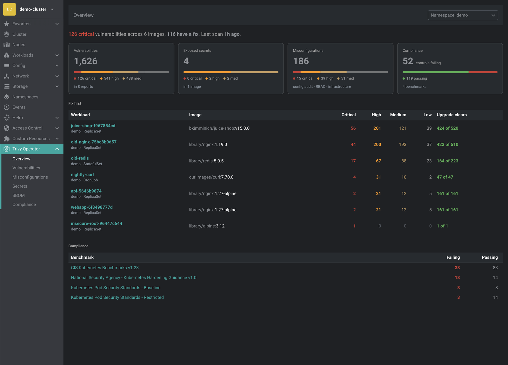
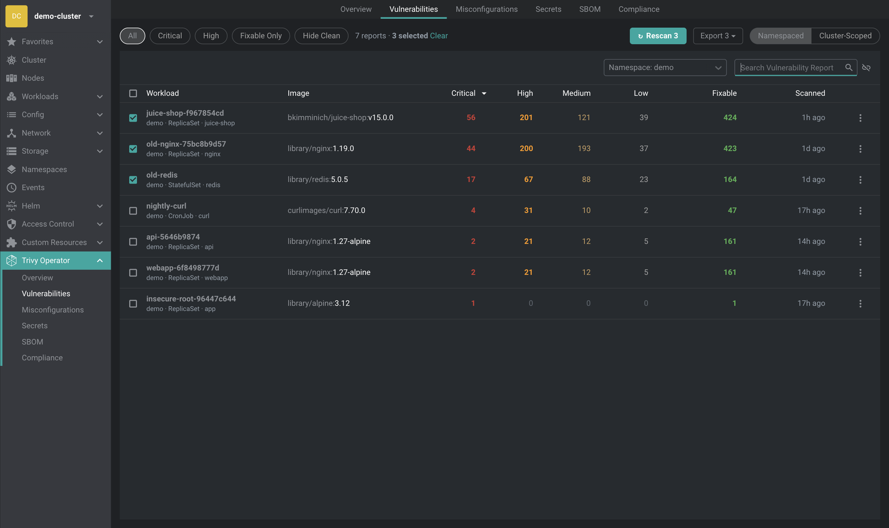
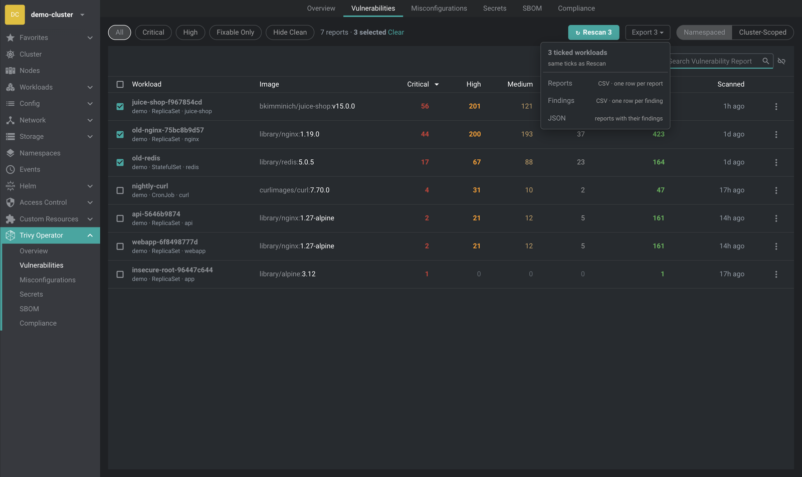

# @hellboyhha/freelens-trivy-operator-extension

[](https://github.com/hellboyhha/freelens-trivy-operator-extension/actions/workflows/check.yaml)
[](https://www.npmjs.com/package/@hellboyhha/freelens-trivy-operator-extension)
[](LICENSE)
[](https://freelens.app/)

A [Freelens](https://freelens.app/) extension that shows the reports of the
[Trivy Operator](https://aquasecurity.github.io/trivy-operator/) inside Freelens, so you can see
what is vulnerable, misconfigured or exposed in a cluster without leaving the app.



The extension reads the report resources and changes nothing, with one exception you start yourself:
**Rescan**. It deletes a report, and the Trivy Operator scans that workload again. Every rescan asks
first, and several at once need you to type the cluster's name. The only code that writes to a cluster is
one file, and a rule in the build enforces that.

## What you get

One **Trivy Operator** entry in the cluster sidebar with six pages:

| Page | What it shows |
|---|---|
| **Overview** | A one-sentence headline, four tiles (vulnerabilities, exposed secrets, misconfigurations, compliance), the images where an upgrade pays off most, and a table of where each compliance benchmark stands. |
| **Vulnerabilities** | One row per workload container, with its Critical, High, Medium and Low counts (each column sorts on its own), the number of findings an upgrade fixes, and the scan age. Switch between namespaced and cluster-scoped reports. |
| **Misconfigurations** | Config audit, RBAC and infrastructure checks in three tabs. |
| **Secrets** | Secrets found inside images, by rule and file. The matched text is never shown. |
| **SBOM** | Software bills of materials. Loaded on request because they are large. Find a package by name, version or purl and see every workload that contains it. |
| **Compliance** | One card per benchmark and its controls, failing first. |

Report drawers group vulnerabilities by package (what to upgrade to, and how many CVEs it clears) and
can copy that list for a ticket. Pod, Deployment, StatefulSet, DaemonSet, Job and CronJob drawers get a
**Trivy Operator** section with one card per container.



**Rescan and Export, on the same ticks.** Every report list has **Rescan** and **Export** at the right
of its toolbar. Both are visible from the start and greyed out until you tick a workload; then they read
*Rescan N* and *Export N* and act on the ticked rows only. The header checkbox ticks every shown row,
and *Clear* next to the count unticks them. Rescan is also a button in a report's drawer and in the
Trivy Operator section of a workload. Compliance reports cannot be rescanned: deleting one deletes the
benchmark itself.

**Scan status.** A rescanned row stays in the list as *Queued*, *Starting scan*, *Scanning* or
*Scan failed* with the reason (for example the registry does not know the image). This is read from the
operator's scan Jobs every few seconds while something waits. The operator removes a failed Job within
seconds, so the extension keeps the failure it saw.

**Export.** Choose *Reports* (CSV, one row per report), *Findings* (CSV, one row per finding) or *JSON*.
Matched secret text is never written, and spreadsheet formulas in titles are defused.



## Requirements

- Freelens 1.x (1.10 or newer)
- A cluster with the Trivy Operator CRDs (`aquasecurity.github.io/v1alpha1`)
- Tested against Trivy Operator 0.31.2 and 0.37.0

## Install

In Freelens, open **Extensions** (`Cmd/Ctrl+Shift+E`). Its install box takes a name, a file path or a URL.

| Way | What to do |
|---|---|
| npm — easiest | Enter `@hellboyhha/freelens-trivy-operator-extension` |
| Release tarball | Download the `.tgz` from the [latest release](https://github.com/hellboyhha/freelens-trivy-operator-extension/releases/latest) and drag it into the window |
| Release URL | Paste the `.tgz` URL into the box |

Then reopen the cluster view. As an ordinary npm package:

```sh
npm install @hellboyhha/freelens-trivy-operator-extension
```

## Permissions

| What the extension does | Kubernetes permission | Where |
|---|---|---|
| Read the 12 report resources | `get`, `list`, `watch` on the CRD groups | All pages |
| Delete reports for Rescan | `delete` on the CRD groups | Rescan only |
| List Jobs and pods for scan status | `get`, `list`, `watch` on `batch/Job` and `core/Pod` in the operator namespace | Scan status only (optional) |

The extension makes no network requests of its own, collects no data, and has no runtime dependencies.

## Contributing

See [CONTRIBUTING.md](CONTRIBUTING.md). One gate: `pnpm check` must pass. Tests are written first. No real data in the repo.

## Security

See [SECURITY.md](SECURITY.md). Report vulnerabilities privately through GitHub Security Advisories.

## License

MIT. See [LICENSE](LICENSE) and [NOTICE](NOTICE).

The sidebar icon uses the cube from the Trivy logo (Apache-2.0, Aqua Security). This project is not affiliated with or endorsed by Aqua Security.

## Links

- [Architecture](docs/ARCHITECTURE.md)
- [Development](docs/DEVELOPMENT.md)
- [Changelog](CHANGELOG.md)